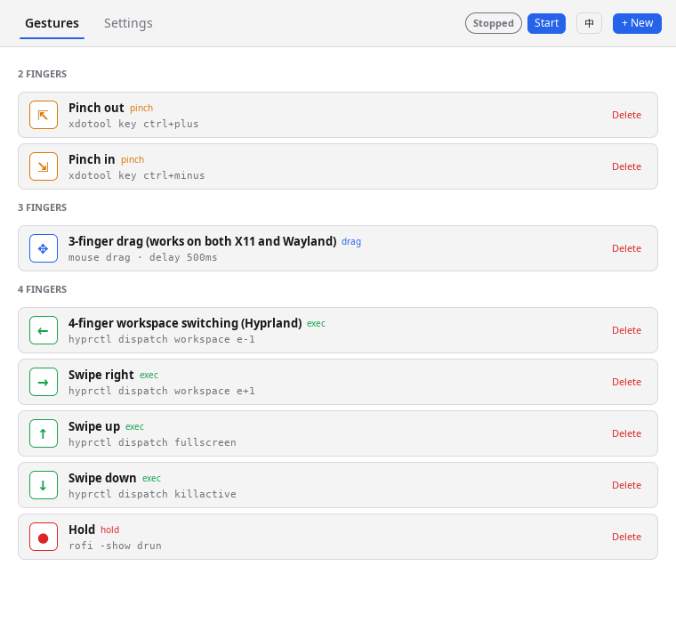

# Gestures

English | [简体中文](./README.zh-CN.md)

A libinput-based touchpad gesture handler and GUI settings panel for Linux. It talks directly to the libinput API instead of parsing debug output, and writes to `/dev/uinput` for low-latency dragging on Wayland (with X11 support).

Pre-compiled packages (`.deb`, Arch Linux `PKGBUILD`) and binaries are available on the [releases page](https://github.com/ferstar/gestures/releases).

## Features

- **Wayland & X11**: Direct `/dev/uinput` virtual pointer on Wayland; direct `libxdo` on X11. Auto-detected at startup.
- **Three-Finger Drag**: macOS-style drag with configurable `mouse-up-delay`.
- **Graphical Settings Panel**: Native GUI (`gestures-panel`) with English and Chinese support for editing gestures and touchpad settings.
- **Desktop Autostart**: Integrates via standard XDG desktop autostart (`~/.config/autostart`).
- **Gesture Types**: Swipe (8 directions + any), Pinch (in/out/rotate), Hold.
- **Touchpad Acceleration**: Optional process-level acceleration profile (`adaptive` / `flat`) and speed setting.
- **Live Reload**: Reload configuration on the fly via IPC (`gestures reload`) without restarting.

## Installation

### Package Managers (Recommended)

#### Debian / Ubuntu

Download the unified `.deb` package from [Releases](https://github.com/ferstar/gestures/releases):

```bash
sudo dpkg -i gestures_1.1.0_amd64.deb
```

This installs the daemon (`gestures`), the GUI (`gestures-panel`), desktop menu entry, and global autostart.

#### Arch Linux

Use the provided `PKGBUILD` in `packaging/arch`:

```bash
cd packaging/arch
makepkg -si
```

Or build directly from the git checkout:

```bash
./scripts/package-arch.sh
sudo pacman -U dist/gestures-*.pkg.tar.zst
```

### Nix Flakes

```nix
# flake.nix
{
  inputs.gestures.url = "github:ferstar/gestures";

  # Then add to packages:
  # inputs.gestures.packages.${system}.gestures
}
```

### With Cargo

```bash
cargo install --git https://github.com/ferstar/gestures.git
```

### Manual Build

```bash
git clone https://github.com/ferstar/gestures
cd gestures

# Build Rust daemon engine
cargo build --release
sudo cp target/release/gestures /usr/bin/

# Build GUI panel (requires Go 1.24+)
cd apps/panel
go build -o build/gestures-panel .
sudo cp build/gestures-panel /usr/bin/
```

## Running & Autostart

### Graphical Panel

Launch **Gestures** from your desktop application launcher, or run:

```bash
gestures-panel
```

From the panel, you can configure gestures, adjust acceleration, and toggle **Desktop Autostart** on or off.

<p align="center">
  
</p>

### Desktop Autostart (CLI)

To start `gestures` automatically upon graphical desktop login:

```bash
# Install autostart desktop entry to ~/.config/autostart/gestures.desktop
gestures install-autostart
```

### Manual CLI Run

```bash
# Start daemon in background or foreground
gestures start

# Reload configuration on the fly
gestures reload

# Generate default configuration (~/.config/gestures.kdl)
gestures generate-config
```

**Note**: The display server is detected via the `WAYLAND_DISPLAY` and `XDG_SESSION_TYPE` environment variables. Manual override is rarely needed.

## Performance Optimizations

This fork includes several performance improvements:

1. **Regex caching**: one-time compilation using `once_cell::Lazy`
2. **Thread pool**: a 4-worker pool prevents PID exhaustion during fast gestures
3. **Input-driven dragging**: direct mouse movement follows touchpad events without a fixed frame-rate limit, retaining fractional pixels for slow-drag precision. The worker coalesces queued movements when needed. Custom swipe update commands remain limited to 60 updates per second.
4. **Timer-based delays**: non-blocking mouse-up delays for smooth dragging
5. **Event caching**: 1-second cache for gesture configuration lookups
6. **Mouse command lifecycle**: a dedicated worker owns a persistent uinput virtual pointer and writes movement/button events directly. If uinput initialization fails, it falls back to ydotool and waits for each child to exit. Its bounded queue coalesces adjacent movement events without crossing button events. On graceful shutdown, the worker drains queued commands, releases any held drag button, destroys its virtual device on exit, and is joined.

## Troubleshooting

### High CPU on Wayland

- Direct dragging has no fixed frame-rate limit; its bounded worker queue coalesces adjacent movement events.
- Custom swipe update commands are limited by `ThrottleState::new(60)` in `crates/gestures/src/event_handler.rs`.
- Check service CPU usage and logs while dragging; resource use depends on the touchpad event rate and command execution speed.

### 3-Finger Drag Not Working

**X11:**

- Ensure the X11 session environment is correct (`DISPLAY` / `XAUTHORITY`)

**Wayland:**

- The default backend writes directly to `/dev/uinput`; `ydotoold` is not required.
- Check logs for the selected backend. Failure to create the virtual pointer logs the reason and falls back to ydotool.
- Ensure the uinput module is loaded and your user can read/write `/dev/uinput`.
- If using the fallback, install `ydotool`, run `ydotoold`, and check its socket permissions.

### Wayland Permission Denied (trackpad or uinput)

Touchpad event access and virtual pointer creation both need appropriate permissions. On distributions using an `input` group:

```bash
# Load the kernel module if /dev/uinput is missing
sudo modprobe uinput

# Add your user to the group (log out and back in afterward)
sudo usermod -aG input "$USER"

# Inspect device ownership and permissions
ls -l /dev/uinput /dev/input/event*
```

If `/dev/uinput` is not group-writable, create `/etc/udev/rules.d/99-gestures-uinput.rules` with:

```udev
KERNEL=="uinput", GROUP="input", MODE="0660"
```

Use your distribution's `uinput` group instead if applicable. Input-group membership also grants access to other input devices. Apply the rule and restart gestures after logging back in:

```bash
sudo udevadm control --reload-rules
sudo udevadm trigger --subsystem-match=misc --sysname-match=uinput
systemctl --user restart gestures.service
```

Only when using the ydotool fallback (or explicit ydotool custom commands):

```bash
systemctl --user enable --now ydotoold.service
systemctl --user status ydotoold.service
ls -la "$XDG_RUNTIME_DIR/.ydotool_socket"
```

Keep `gestures` and `ydotoold` in the same user session for the fallback. Avoid world-writable device or socket permissions.

### `libxdo` Shared Library Error on X11

Symptom:

- `journalctl --user -u gestures` shows:
  - `error while loading shared libraries: libxdo.so.3: cannot open shared object file`

Cause:

- System `xdotool/libxdo` was upgraded (for example to `libxdo.so.4`), but your existing `gestures` binary was built against an older SONAME (`libxdo.so.3`).

Fix:

```bash
# Rebuild and reinstall gestures binary
cargo install --path crates/gestures --force

# Restart user service
systemctl --user restart gestures

# Verify runtime link and logs
ldd ~/.cargo/bin/gestures | grep libxdo
journalctl --user -u gestures -n 50 --no-pager
```

### Conflicts with DE Gestures

Disable built-in gestures in your desktop environment (GNOME, KDE, etc.)

## Alternatives

- [libinput-gestures](https://github.com/bulletmark/libinput-gestures) - Parses debug output
- [gebaar](https://github.com/Coffee2CodeNL/gebaar-libinput) - Swipe only
- [fusuma](https://github.com/iberianpig/fusuma) - Ruby-based
